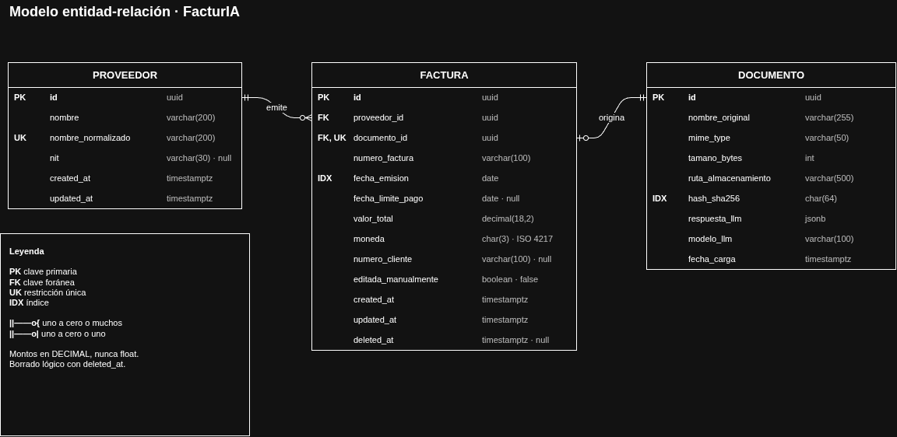
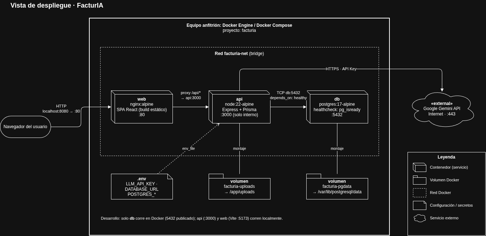
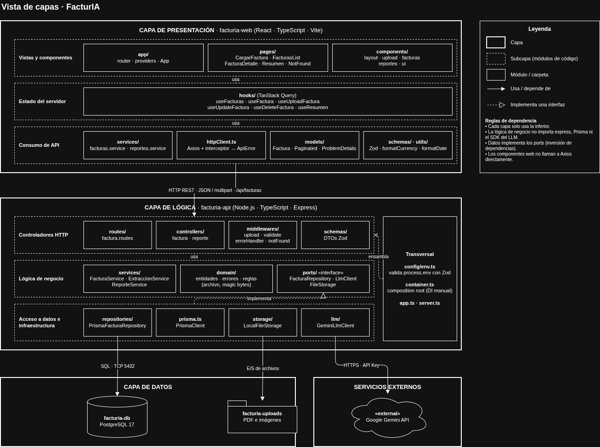

# FacturIA · Extracción inteligente de facturas con LLM

Aplicación web *end-to-end* para cargar facturas de servicios (PDF/PNG/JPG), extraer sus datos clave con un LLM, guardarlas en PostgreSQL y consultarlas desde una interfaz web.

---

## 1. Requerimientos

### 1.1 Funcionales

| ID | Requerimiento |
|---|---|
| RF-01 | Cargar una factura (PDF, PNG o JPG, máx. 10 MB), con vista previa e indicador de progreso. |
| RF-02 | Validar tipo y tamaño del archivo **antes** de invocar el LLM. |
| RF-03 | Extraer con el LLM: fecha de emisión, valor total (decimal) + moneda, proveedor, número de factura. Opcionales: fecha límite de pago, número de cliente/contrato. |
| RF-04 | Validar la respuesta del LLM (estructura y tipos) antes de persistir. |
| RF-05 | Impedir duplicados: misma combinación **proveedor + número de factura**. |
| RF-06 | Guardar el documento (metadatos + respuesta original del LLM) y la factura en **una sola transacción**. |
| RF-07 | Listar facturas con paginación y filtros por proveedor y rango de fechas, resueltos en la BD. |
| RF-08 | Ver el detalle de una factura. |
| RF-09 | Corregir manualmente los datos extraídos (formulario con validaciones). |
| RF-10 | Eliminar una factura (borrado lógico). |
| RF-11 | Reporte: total facturado agrupado por proveedor, mes y moneda (sin mezclar monedas). |

### 1.2 No funcionales

| ID | Requerimiento |
|---|---|
| RNF-01 | Manejador de errores centralizado con formato **Problem Details (RFC 9457)**. |
| RNF-02 | Códigos HTTP coherentes: 400, 404, 409, 413, 415, 422, 500, 502. |
| RNF-03 | API Key del LLM solo por variables de entorno; `.env` fuera del repositorio. |
| RNF-04 | Tipado estricto de extremo a extremo (TypeScript `strict`). |
| RNF-05 | Montos en `DECIMAL`, nunca `float`. |
| RNF-06 | Desacoplamiento: el proveedor de LLM y el ORM se pueden cambiar sin tocar la lógica de negocio. |
| RNF-07 | Ejecución reproducible con `docker compose up`. |
| RNF-08 | Mantenibilidad: capas separadas y pruebas unitarias en la capa de lógica. |

---

## 2. Stack tecnológico

| Capa | Tecnología |
|---|---|
| Frontend (`facturia-web`) | React 18+ · TypeScript · Vite · React Router · React Hook Form + Zod · TanStack Query · Axios |
| Backend (`facturia-api`) | Node.js 26 LTS · TypeScript · Express · Multer · Zod · Prisma |
| Base de datos | PostgreSQL 17 |
| LLM | Google Gemini API (detrás de la interfaz `LlmClient`, intercambiable) |
| Pruebas | Vitest · Supertest |
| Infraestructura | Docker · Docker Compose · nginx |

---

## 3. Arquitectura

SPA en React que consume una API REST en Express, organizada en capas (presentación → lógica → datos) con inversión de dependencias: la lógica define *ports* (`FacturaRepository`, `LlmClient`, `FileStorage`) y la capa de datos los implementa.

### 3.1 Modelo entidad relación para la BD
#### Restricciones e índices

#### Factura
- UNIQUE (proveedor_id, numero_factura) WHERE deleted_at IS NULL — anti-duplicados con borrado lógico (índice parcial)
- UNIQUE (documento_id) — relación 1:1 con documento
- FK proveedor_id → proveedor.id · FK documento_id → documento.id (ON DELETE RESTRICT)
- INDEX (fecha_emision) · INDEX (proveedor_id, fecha_emision)
- CHECK valor_total > 0 · CHECK moneda ~ '^[A-Z]{3}$'
- CHECK fecha_limite_pago IS NULL OR fecha_limite_pago >= fecha_emision

#### Proveedor
- UNIQUE (nombre_normalizado)

#### Documento
- INDEX (hash_sha256)
- CHECK tamano_bytes > 0 AND tamano_bytes <= 10485760 (10 MB)
- CHECK mime_type IN (application/pdf, image/png, image/jpeg)



### 3.1 Vista de componentes y conectores


### 3.2 Vista de despliegue



### 3.3 Vista de capas



---

## 4. Diseño de la API

Base: `/api` · JSON · errores en `application/problem+json`.

| Método | Ruta | Descripción | RF |
|---|---|---|---|
| POST | `/api/facturas` | Carga y extracción (`multipart/form-data`, campo `archivo`) → `201 Created` | 01–06 |
| GET | `/api/facturas?page&pageSize&proveedor&fechaDesde&fechaHasta` | Listado paginado → `{ data, page, pageSize, total, totalPages }` | 07 |
| GET | `/api/facturas/:id` | Detalle | 08 |
| PUT | `/api/facturas/:id` | Corrección manual | 09 |
| DELETE | `/api/facturas/:id` | Borrado lógico → `204 No Content` | 10 |
| GET | `/api/facturas/reportes/resumen?fechaDesde&fechaHasta` | Totales por proveedor, mes y moneda | 11 |

> `/reportes/resumen` se registra **antes** de `/:id` en Express.

### Mapeo de errores

| HTTP | Cuándo | Error de dominio |
|---|---|---|
| 400 | Body/query inválido (Zod), id mal formado | `ValidationError` |
| 404 | Factura no existe o está eliminada | `NotFoundError` |
| 409 | Proveedor + número de factura ya existe | `DuplicateInvoiceError` |
| 413 | Archivo > 10 MB | `PayloadTooLargeError` |
| 415 | Tipo distinto de PDF/PNG/JPG (validado por *magic bytes*) | `UnsupportedMediaTypeError` |
| 422 | Faltan campos obligatorios o no son válidos en la respuesta del LLM | `ExtractionError` |
| 502 | El LLM falla, excede el timeout o responde algo no parseable | `LlmProviderError` |
| 500 | Error no controlado | — |

```json
{
  "type": "https://api.facturia.local/errors/duplicate-invoice",
  "title": "Factura duplicada",
  "status": 409,
  "detail": "Ya existe la factura FE-1234 del proveedor 'Energía S.A.'",
  "instance": "/api/facturas"
}
```

---

## 5. Estructura del proyecto

```
.
├── facturia-api/
│   ├── prisma/                 # schema.prisma · migrations/ · seed.ts
│   ├── src/
│   │   ├── presentation/       # routes · controllers · middlewares · schemas (Zod)
│   │   ├── business/           # services · domain (entidades, errores, reglas) · ports
│   │   ├── data/               # repositories (Prisma) · llm (Gemini) · storage
│   │   ├── config/env.ts       # valida process.env con Zod
│   │   ├── container.ts        # composition root (DI manual)
│   │   ├── app.ts
│   │   └── server.ts
│   ├── tests/
│   │   ├── unit/               # servicios con mocks de los ports
│   │   └── integration/        # Supertest contra la API
│   └── Dockerfile
├── facturia-web/
│   ├── src/
│   │   ├── app/                # router · providers · App
│   │   ├── pages/              # CargarFactura · FacturasList · FacturaDetalle · Resumen · NotFound
│   │   ├── components/         # layout · upload · facturas · reportes · ui
│   │   ├── hooks/              # TanStack Query
│   │   ├── services/           # httpClient (Axios) · facturas · reportes
│   │   ├── models/ · schemas/ · utils/
│   │   └── main.tsx
│   ├── tests/                  # componentes y hooks (Vitest + Testing Library)
│   ├── nginx.conf              # sirve la SPA + proxy /api → api:3000
│   └── Dockerfile
├── image/                      # diagramas de arquitectura
├── docker-compose.yaml
└── .env.example
```

---

## 6. Ejecución

**Requisitos:** Docker Engine + Docker Compose y una API Key de Google Gemini.

```bash
cp .env.example .env          # completar POSTGRES_PASSWORD y LLM_API_KEY
docker compose up --build
```

- Frontend: http://localhost:8080
- API: http://localhost:8080/api

**Desarrollo local** (solo `db` en Docker):

```bash
docker compose up -d db
cd facturia-api && npm install && npx prisma migrate dev && npm run dev   # :3000
cd facturia-web && npm install && npm run dev                             # :5173
```

**Pruebas:**

```bash
cd facturia-api && npm test
cd facturia-web && npm test
```
